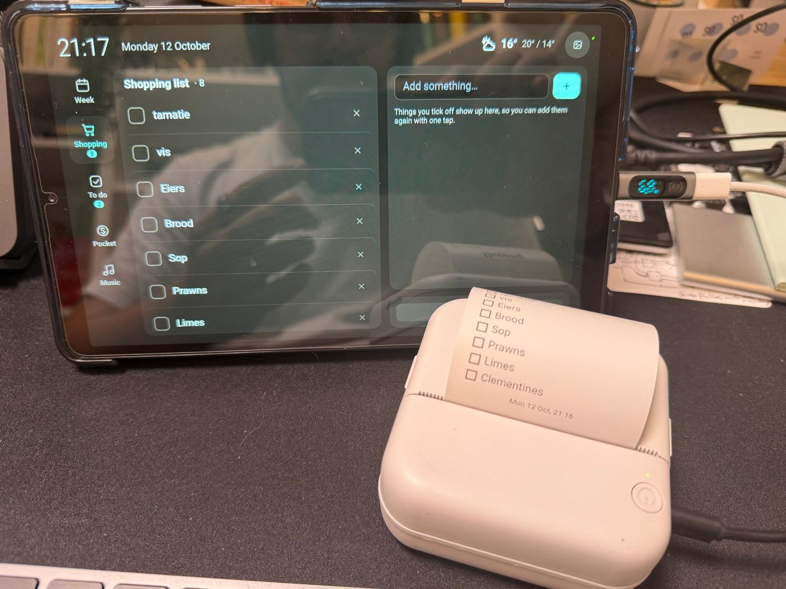

# Hearth

A kitchen wall dashboard on a spare Galaxy Tab A11. It shows public-domain
paintings and family photos until someone walks up. A tap then shows the
week's calendar, the shopping list, the to-dos, the kids' pocket money and
chores, and the kitchen speaker. A red "on a call" banner tells the kids when
not to run into the office. It prints shopping lists and pocket-money receipts
on a cheap Bluetooth thermal printer whose own app nobody could stand.




*Pierre-Auguste Renoir, [Acrobats at the Cirque Fernando](https://www.artic.edu/artworks/81558) (1879),
Art Institute of Chicago, public domain, shown by way of
[frame-art](https://github.com/No1089/frame-art). The shopping list is in
Afrikaans, as it is in the kitchen.*

Two parts:

- **`server/`** is a small Flask app plus one page. It owns no data: lists come
  from the todo app, the calendar, busy state and speaker from Home Assistant,
  balances from the pocket-money app, and pictures from the
  [frame-art](https://github.com/No1089/frame-art) gallery through its
  [JSON API](https://github.com/No1089/frame-art#api) (`/api/works`, `/img/<id>`).
- **`android/`** is a home-made replacement for Fully Kiosk Browser. It runs a
  full-screen WebView, locks the tablet to it, wakes on camera motion and
  drives the printer.
- **`mac/`** is a small agent for the office Mac. It tells Hearth the moment a
  camera, or a microphone for more than a few seconds, is in use. How it knows,
  and the three-line protocol, are in [mac/README.md](mac/README.md).
  [`windows/`](windows/README.md) and [`linux/`](linux/README.md) are the same
  agent for an office that isn't a Mac.

## Why it exists

The cheap smart frames everyone has been
[taking apart this week](https://wesbos.com/hacking-smart-photo-frames) are
Android tablets in a picture-frame shell, sold to get you onto a subscription.
A tablet that has been sitting in a drawer since the kids got iPads is the
same thing with a better screen, and it doesn't need rooting first.

It still needed persuading:

**A tablet wants to be a tablet.** Turn the screen off and Android takes the
camera away, so there is nothing left to notice someone walking up. The app
never turns the screen off. "Asleep" is backlight zero behind a black layer,
and the front camera keeps comparing 32×24 grids of brightness twice a
second.

**Samsung wants it to be a Samsung.** Before the app can lock the tablet as
device owner, every account has to go, including Google Meet's, which outlives
the app being disabled and only leaves after a reboot. Auto Blocker refuses
USB debugging. Freecess freezes the kiosk the moment Settings is in front of
it, and Android won't force-stop a device-owner app, so "until it restarts"
can mean forever. "Exit kiosk" is therefore a ten-minute pause that ends
itself.

**The printer's app is the worst part of the printer.** It's a GB03, one of
the hundreds of identical "cat printers". Its protocol has long since been
worked out by other people, so the tablet talks to it directly:

```
51 78 <cmd> 00 <len> 00 <data…> <crc8(data)> ff    → characteristic ae01
```

Images go out one 384-pixel row at a time, 48 bytes, least significant bit
leftmost. The printer asks you to slow down on `ae02`. The page draws each
receipt on a canvas, so a receipt is just HTML-quality typography squeezed
through a heating element. `tools/catprint.py` is the same driver in Python,
used to prove the protocol from a laptop before any Kotlin was written.

## What's on it

| | |
|---|---|
| **Pictures** | Paintings from the gallery, never cropped, captioned like a wall label. Tap once for the speaker's controls and tap anywhere else for the dashboard. |
| **Week** | Seven days from Home Assistant calendars, colour per calendar, each day's weather. |
| **Shopping** | Tick things off and they return as one-tap "bought before" buttons. **×** removes mistakes, with undo. Prints. |
| **To do** | Every section of the todo app as tabs, Home and Kids first, with done-before suggestions. |
| **Pocket** | Balance and saving goals per kid. Kids tick their own chores, and a parent PIN adds the day. Prints a receipt. |
| **Music** | The kitchen Sonos through Home Assistant, with favourites and a volume cap. |
| **Busy** | Red "on a call" banner, from `mac/busy-agent` or any Home Assistant sensor. |

The page reloads itself after a deploy. It wakes the screen when the busy
banner or a kitchen occupancy sensor turns on, and shows a battery gauge only
when someone has unplugged it.

## The camera

A front camera pointing at the kitchen deserves its own paragraph. It does one
job: noticing that someone has walked up, so the screen comes back on.

Nothing in the app can see a picture. CameraX hands the analyser one frame at
a time; it keeps the luminance plane only, averages it down to a 32×24 grid of
brightness values, compares that grid with the last one, and drops the frame.
No preview, no still capture, no video, no JPEG encoder, no file writes: there
is no code path that turns a frame into an image, so there is nothing to leak.
What leaves the device about motion is a number (`motionFraction` on the
token-gated `/status`) and, if a Home Assistant webhook is configured,
`{"event": "motion"}`.

The dashboard page can't get at the camera either. The WebView never grants
web camera access, and `window.Kiosk` has no camera methods. Android's own
green camera-in-use dot stays on, drawn by the system, and the app can't hide
it.

The exposure that remains is physical. Anyone who can plug in with USB
debugging on can install anything, which is why debugging should be off once
the tablet is on the wall, and why the tablet is best kept off the internet
altogether.

## Running it

```sh
cd server && cp deploy.env.example deploy.env    # fill in
docker compose up -d
```

Or the published image, anywhere a container runs:

```sh
docker run -d --name hearth -p 5007:5007 --env-file deploy.env \
  -v hearth-data:/app/data ghcr.io/no1089/hearth
```

Or with no server at all, as a Home Assistant add-on: Settings → Apps (Add-ons,
until recently) → Install app → ⋮ → Repositories, add
`https://github.com/No1089/hearth`, install Hearth, fill in the form. Lists then
come from HA's own to-do entities, the add-on needs no token, and the tablet
opens `http://<home-assistant-ip>:5007`. A fork, or a copy you're changing,
goes in the `local_apps` share of a Home Assistant OS box instead
(`/local_apps/hearth` over the SSH add-on; Samba also still shows the share
under its old name, `addons`) and appears under "Local apps" in the app store.
The options are in
[server/DOCS.md](server/DOCS.md); how it got here is
[docs/running-elsewhere.md](docs/running-elsewhere.md).

The tablet side, including provisioning and the printer, is in
[android/README.md](android/README.md).

On the office Mac, `mac/install.sh https://hearth.example.com` builds the busy
agent and runs it at login. `--uninstall` removes it.

## Things worth knowing

- The printer powers itself off when idle, charging or not. The app pings it
  every 20 seconds in the hope that counts as busy, and otherwise says
  "press its power button".
- Pocket-money days are set with the pocket app's explicit `edit` call,
  never its toggle. A toggle in that app is how a bought Minecraft book once
  quietly refunded itself.
- The busy agent exists because the Home Assistant Mac app's "camera in use"
  sensor went quietly unavailable on macOS 26, while Core Media I/O still
  answers the same question correctly. The camera counts at once. The mic
  counts after eight seconds, so dictation doesn't send the kids away. A
  report that stops checking in expires after 90 seconds, so a Mac that goes
  to sleep mid-call doesn't leave the banner on all evening.
- Wireless debugging survives until the next reboot. A Mac the tablet already
  trusts over USB can connect without pairing.
